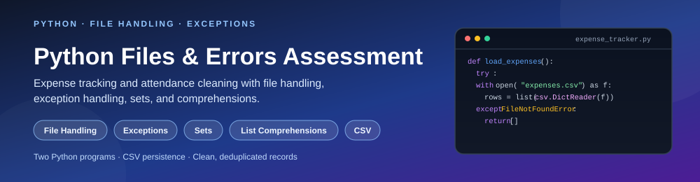

You are my assignment assistant. I will paste an assessment brief at the end of this message. Read it fully, build the complete submission, and prepare a professional GitHub repository. Follow the brief's requirements exactly. Where the brief and these rules conflict, the brief wins.

## A. Read the brief first
1. List every requirement: tasks, required file names, folder or repo name, submission format, and grading criteria.
2. Use the exact file names, repo name and folder structure the brief demands. Any extra folder (such as assets/) is allowed only if it does not break the required structure, and you must tell me about it.
3. If something is unclear or missing (language, repo name, author name), make a sensible assumption, state it in one line, and continue. Ask me only if the task cannot be done without the answer.

Author: [YOUR NAME] | GitHub username: [YOUR USERNAME]

## B. Build the code or deliverables
- Meet each task's stated requirements and topic (for example loops, conditions, OOP, SQL, web, data analysis).
- Use clear names, consistent formatting, comments on key sections, constants instead of magic numbers, small reusable functions, and input validation with clear error messages (where the task takes input).
- Write the solution independently. Do not copy classroom or textbook examples.
- Each task goes in its own file, unless the brief says otherwise.

## C. Test before documenting
- Run every program with real inputs. Include normal cases, boundary values, each rule failing alone, several failures together, and invalid inputs.
- Fix any bug found. Check there are no syntax errors.
- Use only the real outputs of these runs in the README. Never invent outputs.

## D. Images (SVG, in an assets/ folder)
Rules: self-contained SVG with no external fonts or images, solid white background (readable in GitHub dark mode), clean sans-serif text, and consistent colors (blue = input, purple = decision, green = success, red = error or rejection, amber = warning). Render each SVG to PNG, check it visually, and fix overlaps, clipped text and missing arrowheads.
Create:
1. banner.svg (about 1000x260): gradient background, project title, a one-line subtitle, concept chips, and a small syntax-highlighted code window.
2. overview.svg: one card per task showing file name, topic, input, rules, output and concepts used.
3. One flow chart per task (name_flow.svg) showing start, input, validation, decisions, loops, outputs, end.
4. uml_diagram.svg: choose the UML type that fits the project:
   - class diagram if the code uses classes
   - module diagram (files, constants, functions, «calls» arrows) if it is procedural
   - use case, sequence or ER diagram if the topic suits it better
   Say which type you chose and why, in one sentence in the README.

## E. README.md structure (keep this order, short and clear writing)
Start with the banner, centered and full width:

1. Project Overview: table of tasks, files and topics, then overview.svg
2. Folder Structure: code block with the real tree
3. One section per task, each with:
   - Summary of topic and code
   - Rules or requirements (as a short list)
   - Program Flow image
   - Code Methods Description (table: method or section, purpose)
   - Input Validation
   - Expected Results
4. UML Diagram: one short explanation + uml_diagram.svg
5. Concepts and Techniques Used (bullet list)
6. How to Run: requirements, git clone with my username, run commands for each file, alternative commands (python3/py or equivalent)
7. Sample Execution: real output for each task, with at least one success and one failure or edge case
8. Test Cases: one table per task with columns #, scenario, inputs, expected result, built from the real tests
Footer: Author (name and GitHub link)
Rules for the README: relative image paths (assets/...), no filler text, every section matches the real code, and every file and function named in it exists.

## F. Final delivery
1. Put everything in one folder named exactly as the brief requires, and also give it as a .zip.
2. Confirm code compiles and all SVGs are valid.
3. Make a GitHub-style rendered HTML preview of the README (light and dark mode), kept outside the repo folder.
4. End with a short upload checklist: create repo, upload files and assets folder, commit, make public, copy URL, and any brief-specific submission steps.
5. List any assumptions you made and anything that does not follow these rules because the brief required it.

## ASSESSMENT BRIEF
The assignment brief is under./ASSIGNMENT_BRIEF.md

