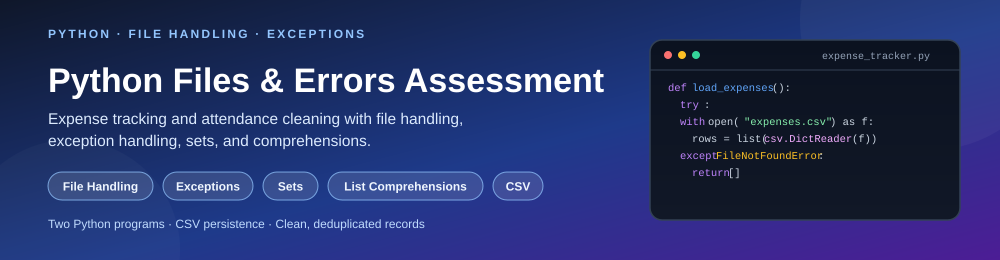
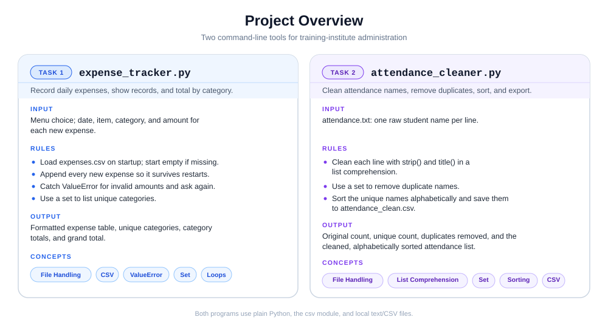
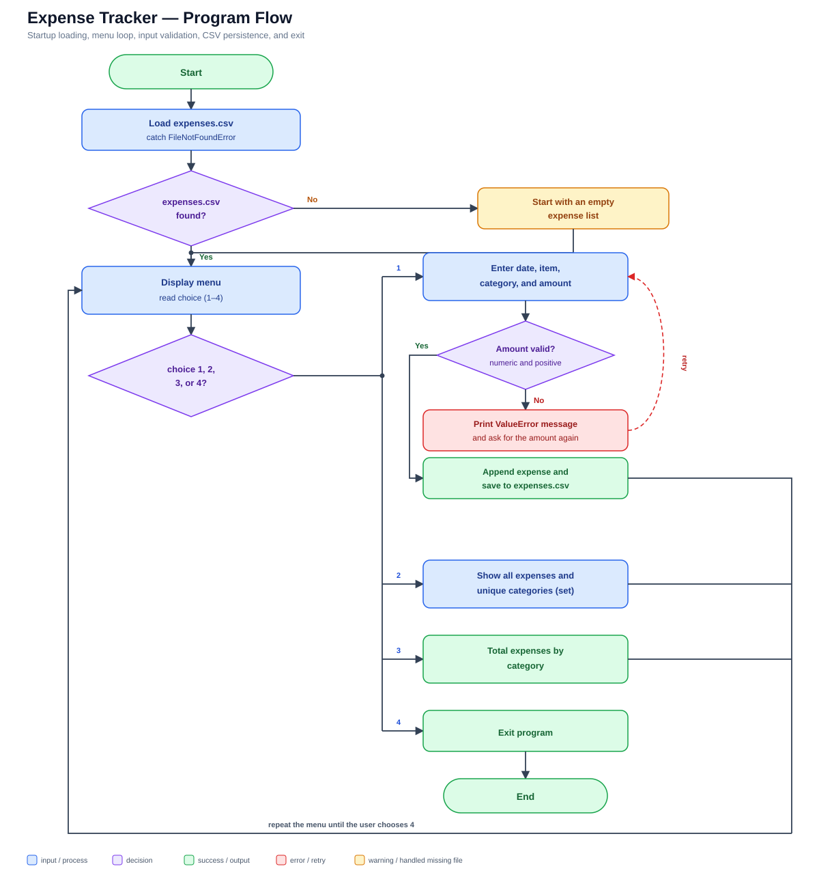
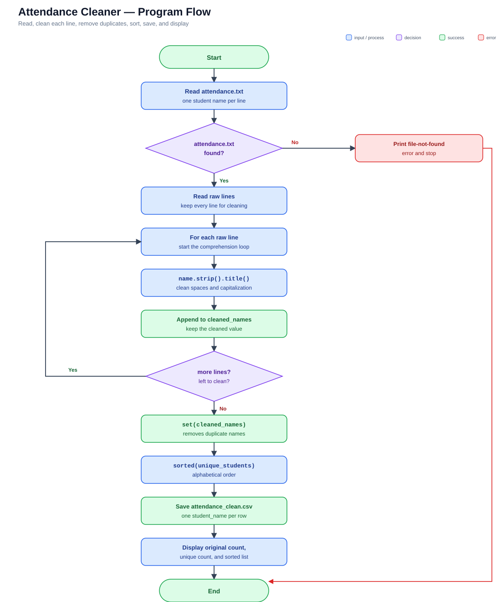
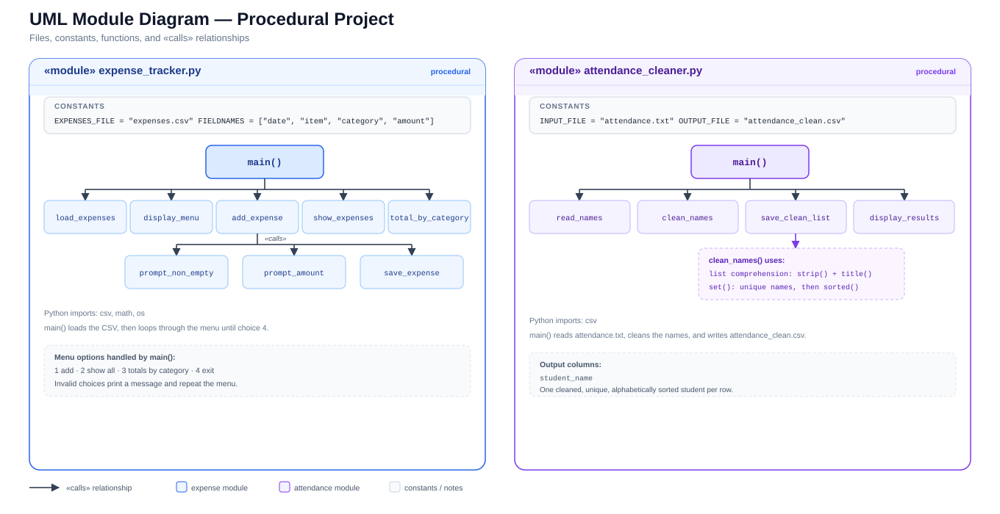

# Python Files & Errors Assessment

<p align="center"></p>

## Project Overview

This repository contains two Python programs for a training institute:
1. **`expense_tracker.py`** - An expense tracking system that manages daily operational costs.
2. **`attendance_cleaner.py`** - A tool to clean and organize student attendance records.

Both programs demonstrate file handling, exception handling, sets, and list comprehensions.

<figure style="text-align: center;">
  
  <figcaption>Project Overview</figcaption>
</figure>

---

## Task 1: Institute Expense Tracker (`expense_tracker.py`)

### Summary
A command-line application that manages expense records in a CSV file. It allows adding new expenses, viewing all expenses, calculating totals by category, and exits the program.

### Rules
1. Loads expenses from `expenses.csv` on startup, or starts empty if the file doesn't exist.
2. Saves every new expense to the CSV file.
3. Validates that the amount is a positive number.
4. Uses a set to display unique expense categories.

### Program Flow
<figure style="text-align: center;">
  
  <figcaption>Expense tracker program flow</figcaption>
</figure>

### Code Methods Description
| Method/Section | Purpose |
|---------------|---------|
| `load_expenses()` | Reads existing expenses from CSV |
| `save_expense()` | Appends a new expense to CSV |
| `prompt_non_empty()` | Validates non-empty text input |
| `prompt_amount()` | Validates numeric, positive amount input |
| `add_expense()` | Handles adding a new expense with validation |
| `show_expenses()` | Displays all expenses and categories |
| `total_by_category()` | Calculates totals per category |
| `display_menu()` | Shows the main menu options |
| `main()` | Orchestrates the program loop |

### Input Validation
- **Date**: Must be a valid date format (YYYY-MM-DD)
- **Item**: Cannot be empty
- **Category**: Cannot be empty
- **Amount**: Must be a positive number (e.g., 25.50)

### Expected Results
- Successful addition of expenses is confirmed with a message.
- All expenses are displayed with proper formatting.
- Category totals are calculated and displayed.
- Empty state shows appropriate messages.

### Test Cases
| # | Scenario | Inputs | Expected Result |
|---|----------|--------|----------------|
| 1 | First run, add expense | Date: 2026-11-15, Item: Printer paper, Category: Stationery, Amount: 45.50 | Expense saved, displayed, and can be loaded next run |
| 2 | Invalid amount input | Amount: abc | "Invalid amount. Enter a number, for example 25.50." |
| 3 | Empty required field | Item: (blank) | "This field cannot be empty. Please try again." |
| 4 | Empty expense state | No menu options chosen | "No expenses have been recorded yet." |
| 5 | Multiple categories | Add several expenses across different categories | Displays all categories and correct totals |

---

## Task 2: Student Attendance Cleaner (`attendance_cleaner.py`)

### Summary
A program that reads attendance records from a text file, cleans them by removing whitespace and inconsistent capitalization, removes duplicates, sorts alphabetically, and saves the result to a CSV file.

### Rules
1. Reads student names from `attendance.txt` (one per line).
2. Cleans names using `strip()` and `title()` with a list comprehension.
3. Uses a set to identify unique students.
4. Sorts the cleaned names alphabetically.
5. Saves the final list to `attendance_clean.csv`.

### Program Flow
<figure style="text-align: center;">
  
  <figcaption>Attendance cleaner program flow</figcaption>
</figure>

### Code Methods Description
| Method/Section | Purpose |
|---------------|---------|
| `read_names()` | Reads all lines from attendance file |
| `clean_names()` | Cleans and deduplicates names using list comprehension |
| `save_clean_list()` | Writes cleaned names to CSV |
| `display_results()` | Shows original count, unique count, and cleaned list |

### Input Validation
- The program checks if the input file exists.
- Handles empty or whitespace-only files.

### Expected Results
- Displays original record count and unique student count.
- Shows how many duplicates were removed.
- Displays the cleaned, sorted attendance list.
- Saves the result to `attendance_clean.csv`.

### Test Cases
| # | Scenario | Inputs | Expected Result |
|---|----------|--------|----------------|
| 1 | Normal file with duplicates | attendance.txt with mixed case and spaces | 8 original records, 5 unique students, sorted list |
| 2 | Missing input file | No attendance.txt | "Error: attendance.txt was not found." |
| 3 | Empty input file | Empty attendance.txt | "No student records found in the file." |
| 4 | Already clean input | Clean attendance.txt | 3 original records, 3 unique students |

---

## UML Diagram

This project uses a **module diagram** showing the relationships between files, constants, functions, and calls.

<figure style="text-align: center;">
  
  <figcaption>UML Module Diagram - Procedural Project</figcaption>
</figure>

The diagram shows the expense and attendance modules as procedural components with their constants, functions, and the "calls" relationships between them.

---

## Concepts and Techniques Used

- **File Handling**: Reading from and writing to CSV files.
- **Exception Handling**: `FileNotFoundError` and `ValueError` handling.
- **Sets**: To identify unique categories and students.
- **List Comprehensions**: For cleaning and processing attendance names.
- **CSV Module**: For structured data storage and retrieval.
- **Input Validation**: User input checks and error messages.
- **Procedural Programming**: Functions and modules organized as separate files.

---

## How to Run

### Prerequisites
- Python 3.10 or higher
- Chrome browser (for rendering SVGs)

### Installation
1. Clone the repository:
   ```bash
   git clone https://github.com/hafsapixie/python-files-errors-assessment.git
   cd python-files-errors-assessment
   ```

2. Install dependencies (if needed):
   ```bash
   pip install pywinpty
   pip install playwright
   ```

### Running the Programs

#### Expense Tracker
```bash
python expense_tracker.py
```

#### Attendance Cleaner
```bash
python attendance_cleaner.py
```

### Alternative (for SVG rendering)
```bash
python assessment_runs/render_svgs.py
```

---

## Sample Execution

### Expense Tracker Execution
```
Institute Expense Tracker
  expenses.csv not found. Starting with an empty expense list.
Loaded 0 saved expense record(s).

===== Institute Expense Tracker =====
1. Add New Expense
2. Show All Expenses
3. Calculate Total Expenses by Category
4. Exit
Enter choice (1-4): 1
--- Add New Expense ---
Date (YYYY-MM-DD): 2026-11-15
Item name: Printer paper
Category (for example, Stationery): Stationery
Amount: 45.50
  Saved: Printer paper | Stationery | 45.50

===== Institute Expense Tracker =====
1. Add New Expense
2. Show All Expenses
3. Calculate Total Expenses by Category
4. Exit
Enter choice (1-4): 2

Date         Item                     Category               Amount
--------------------------------------------------------------------
2026-11-15   Printer paper            Stationery              45.50

Unique categories (1): Stationery

===== Institute Expense Tracker =====
1. Add New Expense
2. Show All Expenses
3. Calculate Total Expenses by Category
4. Exit
Enter choice (1-4): 4
Goodbye!
```

### Attendance Cleaner Execution
```
Student Attendance Cleaner
Original records: 8
Unique students: 5
Duplicates removed: 3

Cleaned attendance list (sorted):
  1. Alice Johnson
  2. Bob Smith
  3. Charlie Brown
  4. David Lee
  5. Eva Green

Saved cleaned list to attendance_clean.csv.
```

---

## Test Cases

### Expense Tracker Test Cases
| # | Scenario | Input | Expected Result |
|---|----------|-------|----------------|
| 1 | First run, add expense | 2026-11-15, Printer paper, Stationery, 45.50 | Saved expense, can be loaded next run |
| 2 | Invalid amount | abc | "Invalid amount. Enter a number, for example 25.50." |
| 3 | Empty field | (blank) | "This field cannot be empty. Please try again." |
| 4 | Empty state | No choice | "No expenses have been recorded yet." |
| 5 | Multiple categories | Add expenses across different categories | Displays all categories and correct totals |

### Attendance Cleaner Test Cases
| # | Scenario | Input | Expected Result |
|---|----------|-------|----------------|
| 1 | Normal file | attendance.txt with mixed case | 8 original records, 5 unique, sorted list |
| 2 | Missing file | No attendance.txt | Shows file not found error |
| 3 | Empty file | Empty attendance.txt | Shows no records found |
| 4 | Clean input | Clean attendance.txt | 3 original records, 3 unique students |

---

## Author

**Hafsa Naseer**  
GitHub: [hafsapixie](https://github.com/hafsapixie)